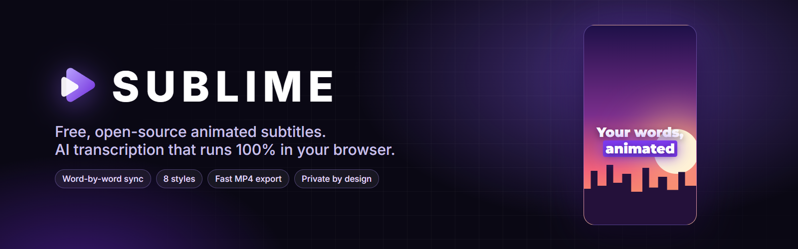
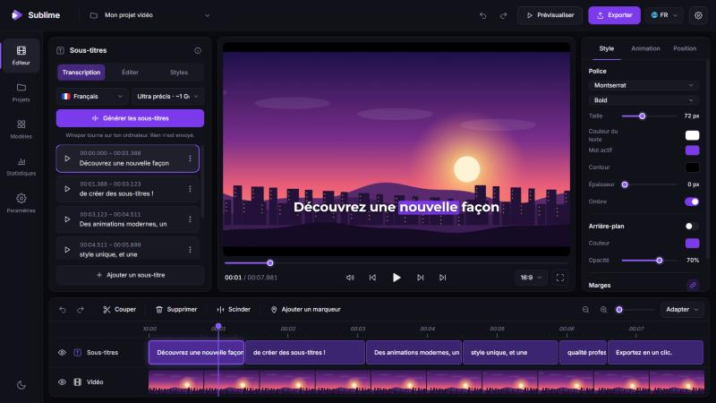

<p align="center">
  
</p>

<p align="center">
  <b>Des sous-titres animés style TikTok, gratuits, directement dans ton navigateur.</b><br>
  <a href="https://pixelnorth.github.io/sublime/"><b>▶ Essayer maintenant</b></a> · <a href="README.md">English</a>
</p>



## Fonctionnalités

- **Transcription IA locale** (Whisper) : 3 modèles, timing mot par mot, 6 langues ou détection automatique.
- **Orthographe** : dictionnaire perso (`Etsy` ne devient plus « ETIS »), mots recollés automatiquement, correcteur du navigateur, rechercher / remplacer.
- **Édition** : texte et timings modifiables, timeline avec glisser-déposer, couper / scinder / fusionner, marqueurs, annuler / rétablir, import et export `.srt`.
- **Styles** : 8 modèles + les tiens, police, couleurs, contour, ombre, fond, marges. Animations Pop, Reveal, Fondu, Glisse. Formats 16:9, 9:16, 1:1, 4:5.
- **Export MP4 rapide** par la carte graphique, avec fenêtre « Enregistrer sous » (Chrome / Edge).
- **Projets sauvegardés** dans le navigateur, **statistiques** de lisibilité, interface en **français, anglais et espagnol**, thème sombre ou clair.

## Lancer en local

```bash
git clone https://github.com/pixelnorth/sublime.git
cd sublime
python -m http.server 5173
```

Puis ouvre http://localhost:5173.

## Confidentialité

Ta vidéo et ton audio sont traités **uniquement sur ton appareil**, rien n'est envoyé. La page télécharge seulement le modèle Whisper (une fois), deux bibliothèques et des polices.

## Limites connues (bêta)

- Testé sur Chrome et Edge récents. Firefox et Safari pas encore testés.
- Le modèle **Ultra** pèse environ 1 Go (téléchargé une fois) et demande une carte graphique.
- Une très grosse vidéo peut ne pas tenir dans le stockage du navigateur.

## Contribuer

Voir [CONTRIBUTING.md](CONTRIBUTING.md). Licence [MIT](LICENSE).
