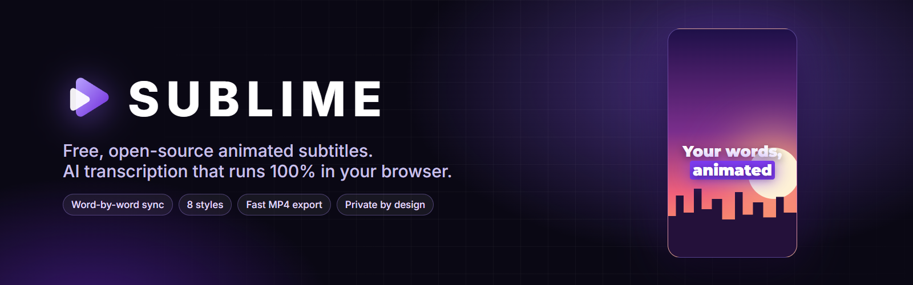
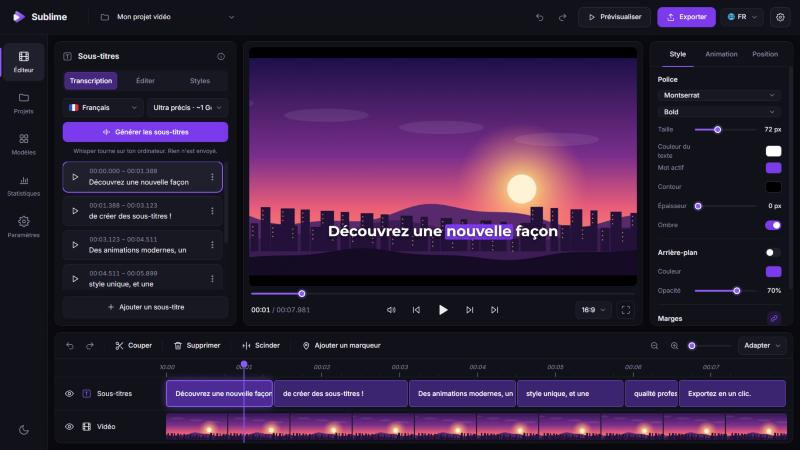

<p align="center">
  
</p>

<p align="center">
  <b>Turn any video into TikTok-style animated subtitles — in your browser, for free.</b><br>
  AI transcription with word-by-word timing, 8 ready-made styles, fast MP4 export. Your video never leaves your device.
</p>

<p align="center">
  <a href="https://pixelnorth.github.io/sublime/"><b>▶ Try it now</b></a> ·
  <a href="#features">Features</a> ·
  <a href="#run-it-locally">Run locally</a> ·
  <a href="#privacy">Privacy</a> ·
  <a href="#contributing">Contributing</a> ·
  <a href="README.fr.md">Français</a>
</p>

<p align="center">
  
  
  
  
</p>



## Why SUBLIME?

Animated captions keep viewers watching, but most tools that make them are paid, need an account, or upload your footage to a server. SUBLIME does it all locally: open the page, drop a video, export. No sign-up, no watermark, no upload.

## Features

**AI transcription, on your machine**
- [Whisper](https://github.com/openai/whisper) runs in the browser through [Transformers.js](https://github.com/huggingface/transformers.js) (WebGPU when available, WebAssembly otherwise).
- Three models: **Ultra accurate** (large-v3-turbo), **Accurate** (small), **Fast** (base).
- **Word-level timestamps**, so each word lights up exactly when it is spoken.
- French, English, Spanish, German, Italian, Portuguese, or automatic detection.

**Spelling you can trust**
- **Personal dictionary**: add `Etsy` once and it stops being transcribed as "ETIS". Sound-alike words are fixed too.
- Word fragments are re-joined automatically (`aujourd'` + `hui`, `l'` + `homme`).
- Browser spell-check in the editor, plus find & replace across all subtitles.

**Editing**
- Edit text and timings directly in the subtitle list.
- **Timeline** with a subtitle track and video thumbnails: drag blocks to move them, pull their edges to resize.
- Cut, split, merge, duplicate, markers, undo / redo.
- `.srt` import and export.

**Styles & animation**
- **8 built-in styles** plus your own saved templates.
- Font, weight, size, colors, outline, shadow, background box, padding.
- Entrance animations: **Pop, Reveal (word by word), Fade, Slide**. Active word highlighted with a color or a box.
- **16:9, 9:16, 1:1 and 4:5** output.

**Export**
- **GPU-accelerated MP4 export** (WebCodecs via [Mediabunny](https://github.com/Vanilagy/mediabunny)), usually much faster than real time.
- **"Save as" dialog** to choose where the file goes (Chrome / Edge).
- Adjustable quality and frame rate. Also exports `.srt` and `.png` frames.

**Everything else**
- **Projects auto-saved** in your browser, video included.
- **Readability stats**: words per minute, lines that are too fast to read.
- Interface in **English, French and Spanish**. Dark and light themes.
- Shortcuts: `Space` play · `S` split · `M` marker · `Del` delete · `Ctrl+Z` / `Ctrl+Y` · `Ctrl+S` save.

## Run it locally

No install, no build. You only need a static file server (opening `index.html` directly does not work, because of ES modules and Web Workers).

```bash
git clone https://github.com/pixelnorth/sublime.git
cd sublime
python -m http.server 5173
```

Then open http://localhost:5173.

## Privacy

- Your **video and audio are processed entirely on your device**. Nothing is uploaded.
- The page downloads only static files: the Whisper model from Hugging Face (once, then cached), two libraries from jsDelivr, and fonts from Google Fonts.
- Projects, templates and settings are stored **in your browser** (IndexedDB / localStorage). Clearing site data deletes them.

## Known limitations

SUBLIME is in **beta**. Please [report what breaks](https://github.com/pixelnorth/sublime/issues).

- Tested on recent **Chrome and Edge**. Firefox and Safari are not tested yet; the "Save as" dialog is Chromium-only.
- The **Ultra** model is a ~1 GB one-time download and needs a GPU (WebGPU) to be fast. On weaker machines, pick **Fast** or **Accurate**.
- Very large videos may not fit in browser storage; the project then stays open but is not saved.
- If fast export is not supported, SUBLIME falls back to a slower real-time export.
- Transcription quality depends on the audio. Use the personal dictionary for names and brands.

## Tech stack

Plain **HTML, CSS and JavaScript**: no framework, no bundler, no dependencies to install.

| File | Role |
|---|---|
| `index.html` | Interface |
| `style.css` | Dark and light themes |
| `app.js` | Editor, subtitle rendering, projects, export |
| `worker.js` | Whisper transcription in a Web Worker |
| `i18n.js` | Interface translations |

## Contributing

Bug reports, ideas, new subtitle styles and translations are very welcome. Read [CONTRIBUTING.md](CONTRIBUTING.md) to get started.

**Add a language:** copy the `en` block in `i18n.js` and translate the values.

## License

[MIT](LICENSE). Free to use, modify and share.

---

<p align="center">
  If SUBLIME saves you time, a ⭐ helps other creators find it.<br>
  <a href="https://pixelnorth.github.io/sublime/">pixelnorth.github.io/sublime</a> · <a href="https://github.com/pixelnorth/sublime">github.com/pixelnorth/sublime</a>
</p>
